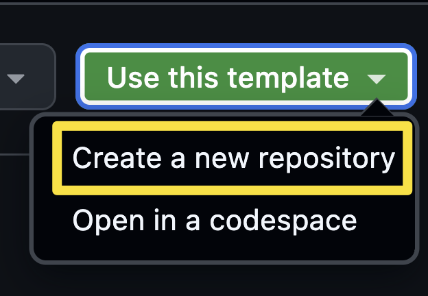

O aplicativo GitHub Copilot é um aplicativo para desktop que funciona como ponto central para o Copilot e o GitHub. Ele oferece acesso rápido a issues e pull requests e permite desenvolver com o GitHub Copilot. Durante este workshop, você trabalhará localmente com o aplicativo Tailspin Toys, criado com Astro, usando o aplicativo GitHub Copilot. Antes de começar, verifique se o Node.js está instalado localmente e, em seguida, instale o aplicativo Copilot.

Nesta lição, você vai:

- instalar o Node.js para que os testes do projeto possam ser executados no computador.
- criar uma cópia própria do projeto Tailspin Toys a partir do template.

## Instalar o Node.js

Em várias lições, você pedirá a um agente para criar recursos e executar o conjunto de testes do Tailspin Toys localmente. Para isso, é necessário o [Node.js][nodejs] — o único runtime exigido pelo projeto. Instale a versão **LTS** atual.

A opção mais simples em todas as plataformas é usar o instalador oficial:

1. Abra uma janela do terminal no sistema operacional usando o Windows Terminal, o Terminal do macOS ou o aplicativo que costuma usar.
2. Execute os comandos a seguir para verificar as versões instaladas do Node.js e do npm:

    ```shell
    node --version
    npm --version
    ```

3. Se os dois comandos forem executados e o Node.js atender aos requisitos descritos no README e em `package.json` do projeto, passe para a próxima seção.

> [!TIP]
> Só é necessário concluir estas etapas se o Node não estiver instalado ou precisar ser atualizado.

4. Acesse a [página de download do Node.js][node-download].
5. Baixe a versão **LTS** para seu sistema operacional.
6. Execute o instalador e aceite as opções padrão. No Windows, mantenha selecionada a opção **Add to PATH**.
7. Depois da instalação, abra uma nova janela do terminal.
8. Confirme a instalação na nova janela executando:

    ```bash
    node --version
    npm --version
    ```

9. Você deverá ver as versões instaladas do Node.js e do npm.

> [!IMPORTANT]
> O agente do aplicativo Copilot também precisa conseguir executar `node --version` e `npm --version`. O fato de os comandos funcionarem no terminal habitual não garante que estejam disponíveis para o aplicativo. Feche completamente e reabra o aplicativo depois de instalar o Node.js ou alterar o PATH. Se algum comando continuar falhando em uma sessão, siga as [etapas para solucionar problemas do ambiente da sessão][session-environment] antes de continuar.

> [!IMPORTANT]
> Cada worktree também precisa das dependências do projeto e do Chromium do Playwright para as verificações E2E. Siga o README do repositório Tailspin Toys ao preparar uma worktree e revise qualquer solicitação de instalação antes de aprová-la.

## Configurar o repositório do laboratório

Você trabalhará na sua própria cópia do projeto Tailspin Toys. Crie-a agora a partir do [repositório template][template-repository]. O novo repositório terá todos os arquivos necessários para o laboratório e será conectado ao aplicativo na próxima lição.

1. Em uma nova janela do navegador, acesse o repositório do GitHub deste laboratório: `https://github.com/github-samples/tailspin-toys`.
2. Crie sua cópia do repositório selecionando o botão **Use this template** na página do repositório do laboratório. Em seguida, selecione **Create a new repository**.

    

3. Se estiver participando de um evento conduzido pelo GitHub ou pela Microsoft, siga as instruções fornecidas pelas pessoas mentoras. Caso contrário, crie o novo repositório em uma organização na qual você tenha acesso ao GitHub Copilot.

    

4. Anote o caminho do repositório que criou (**organization-or-user-name/repository-name**), pois você o usará mais adiante no laboratório.

> [!NOTE]
> Ao criar o repositório a partir do template, um backlog de issues do GitHub é criado automaticamente. Você usará essas issues durante o workshop — não precisa criar nenhuma.

Use uma cópia nova do template do workshop. Ela inclui instruções do repositório, o código do aplicativo, testes, uma skill `quality-checks` e uma extensão de canvas existente. Você personalizará a skill e criará um agente de QA durante o workshop. Se usar uma cópia mais antiga, confirme com a pessoa que está facilitando o workshop se ela contém os arquivos necessários.

## Resumo e próximos passos

Seu ambiente está pronto. Nesta lição, você:

- instalou o Node.js para que o projeto possa ser compilado e testado no computador.
- criou uma cópia própria do repositório Tailspin Toys a partir do template.

Em seguida, você [instalará o aplicativo GitHub Copilot][next-lesson], conectará o repositório recém-criado e conhecerá o espaço de trabalho.

## Recursos

- [Baixar o Node.js][node-download]
- [Criar um repositório a partir de um template][template-repository]
- [Sobre o aplicativo GitHub Copilot][about-copilot-app]

[next-lesson]: ../1-install-copilot-app/
[nodejs]: https://nodejs.org/
[node-download]: https://nodejs.org/en/download
[template-repository]: https://docs.github.com/repositories/creating-and-managing-repositories/creating-a-template-repository
[about-copilot-app]: https://docs.github.com/copilot/concepts/agents/github-copilot-app
[session-environment]: ../3-agent-modes/#iniciar-uma-sessao-a-partir-da-issue
