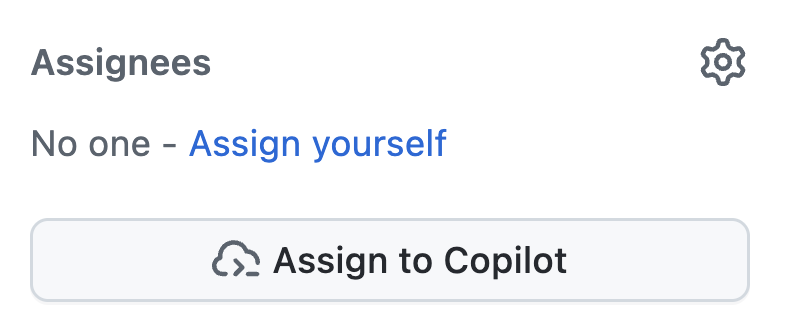

| [← Lição anterior: Instruções personalizadas][previous-lesson] |
|:--|

É provável que poucas organizações não enfrentem problemas com dívida técnica. Ela pode incluir problemas de segurança não resolvidos, código legado que precisa de atualizações ou solicitações de funcionalidades paradas no backlog por falta de tempo para implementá-las. O agente de nuvem do GitHub Copilot foi criado para executar tarefas como atualizar código e adicionar funcionalidades de forma autônoma. Quando termina, ele cria uma pull request em rascunho para que uma pessoa desenvolvedora a revise. Assim, você pode delegar tarefas repetitivas, acelerar o desenvolvimento e se concentrar em objetivos mais amplos.

Neste exercício, você explorará o agente de nuvem do Copilot para:

- personalizar o ambiente de geração de código.
- garantir que as operações sejam executadas com segurança.
- entender a importância de issues bem delimitadas.
- atribuir issues ao Copilot.

## Cenários

A Tailspin Toys tem algumas dívidas técnicas para resolver. As pessoas contratadas inicialmente para criar a primeira versão do site deixaram a documentação em um estado inadequado — na verdade, não há documentação. Como primeira etapa, a equipe quer adicionar comentários TSDoc a todas as funções exportadas do aplicativo.

Além disso, a equipe de design está pronta para melhorar a descoberta de jogos. Ela quer que a página de detalhes de cada jogo mostre jogos relacionados — outros títulos da mesma categoria — para que as pessoas possam continuar navegando. Por enquanto, não é necessário criar uma implementação refinada; basta algo que a equipe possa usar para testes de aceitação da experiência. O trabalho está bloqueado, mas há outras issues de prioridade mais alta no momento.

Esses são exemplos de tarefas que podem ser adiadas com facilidade e que são ideais para atribuir ao agente de nuvem do Copilot. Ele pode trabalhar nelas de forma assíncrona enquanto você se concentra em outras tarefas. Depois, você pode voltar para revisar o trabalho e confirmar se o resultado está correto.

## Introdução ao agente de nuvem do GitHub Copilot

O [agente de nuvem do GitHub Copilot](https://docs.github.com/copilot/concepts/agents/cloud-agent/about-cloud-agent#overview-of-copilot-cloud-agent-formerly-copilot-coding-agent) executa tarefas em segundo plano de forma semelhante a uma pessoa desenvolvedora. Como no trabalho com outras pessoas, há várias maneiras de iniciar uma tarefa, inclusive [atribuir uma issue do GitHub ao Copilot](https://docs.github.com/copilot/how-tos/use-copilot-agents/cloud-agent/start-copilot-sessions). Depois de receber a atribuição, o Copilot cria uma pull request em rascunho para acompanhar o progresso, prepara um ambiente e começa a trabalhar. Você pode acompanhar a sessão enquanto o trabalho está em andamento ou depois que terminar. Quando a solução proposta estiver pronta para revisão, o Copilot marcará você na pull request.

## A importância de instruções bem delimitadas

Não há mágica no GitHub Copilot — não é possível pular a etapa de raciocínio. Até mesmo tarefas aparentemente simples ficam complexas quando examinadas de perto; por isso, [delimite cuidadosamente as tarefas atribuídas ao agente de nuvem do Copilot][cloud-agent-best-practices]. Trate-o como um par de programação com IA: trabalhe por etapas, aprenda, experimente e adapte o processo. Os fundamentos do desenvolvimento de software não mudam com a chegada da IA generativa.

## Instruções personalizadas neste repositório

Nos exercícios anteriores, você aprendeu sobre instruções personalizadas e como elas orientam o Copilot. Se já concluiu o exercício prático sobre instruções personalizadas, viu `.github/copilot-instructions.md` em ação; caso contrário, este é um bom momento para dar uma olhada rápida. Antes de atribuir trabalho ao agente de nuvem, leia os arquivos de instruções incluídos neste repositório, sem alterá-los, para depois identificar seus efeitos.

Abra os arquivos a seguir na interface Web do GitHub ou em um Codespace, se já houver um aberto:

- `.github/copilot-instructions.md`: revise a seção **Code standards**, principalmente as expectativas para convenções TypeScript e comentários TSDoc.
- `.github/instructions/unit-tests.instructions.md`: observe o frontmatter `applyTo`, que aplica essas instruções aos arquivos `**/*.test.ts`.

Ao atribuir a issue `Code lacks documentation` ao agente de nuvem na próxima seção, observe na pull request resultante os comentários TSDoc, as convenções TypeScript e os cabeçalhos de comentários. Esses elementos vêm dos arquivos de instruções que você verá mais adiante, ao revisar as PRs.

## Configurar o ambiente de desenvolvimento do agente de nuvem do Copilot

Criar código, seja qual for a pessoa responsável, geralmente exige um ambiente específico e alguns scripts de configuração para garantir que tudo esteja pronto. O mesmo vale para tarefas atribuídas ao Copilot, que trabalha de maneira semelhante a uma pessoa engenheira de software.

O agente de nuvem usa o [GitHub Actions][github-actions] como ambiente de trabalho. Você pode personalizar esse ambiente criando um [fluxo de trabalho de configuração especial][setup-workflow] no arquivo `.github/workflows/copilot-setup-steps.yml`, que será executado antes de o agente começar o trabalho. Assim, o agente terá acesso às ferramentas de desenvolvimento e dependências necessárias. Esse fluxo já foi configurado para o laboratório, para facilitar as atividades e a experiência de aprendizagem. Ele disponibiliza Node.js, dependências do projeto, binários de navegador para testes de ponta a ponta e o banco de dados SQLite migrado e preenchido com dados para o aplicativo Astro:

```yaml
name: "Copilot Setup Steps"

# Allows you to test the setup steps from your repository's "Actions" tab
on: workflow_dispatch

env:
  ASTRO_TELEMETRY_DISABLED: "1"

jobs:
  copilot-setup-steps:
    runs-on: ubuntu-latest
    # Set the permissions to the lowest permissions possible needed for *your steps*. Copilot will be given its own token for its operations.
    permissions:
      # If you want to clone the repository as part of your setup steps, for example to install dependencies, you'll need the `contents: read` permission. If you don't clone the repository in your setup steps, Copilot will do this for you automatically after the steps complete.
      contents: read
    steps:
      - name: Checkout code
        uses: actions/checkout@v5

      # Frontend / app setup - Node.js (the whole app is now Astro + Drizzle/libSQL)
      - name: Set up Node.js
        uses: actions/setup-node@v6
        with:
          node-version: "lts/*"
          cache: "npm"
          cache-dependency-path: "./package-lock.json"

      - name: Install JavaScript dependencies
        run: npm ci

      - name: Install Playwright browsers
        run: npx playwright install --with-deps chromium

      # Migrate + seed the local SQLite database so builds and tests have data.
      - name: Set up the database
        run: npm run db:setup
```

O arquivo parece qualquer outro fluxo de trabalho do GitHub, mas tem alguns pontos importantes:

- Ele contém um único trabalho, chamado `copilot-setup-steps`, executado no GitHub Actions antes de o Copilot começar a trabalhar na pull request.
- Observe o gatilho `workflow_dispatch`, que permite executar o fluxo manualmente na guia **Actions** do repositório. Assim, você pode confirmar se ele funciona sem esperar o Copilot executá-lo.

## Adicionar documentação

Embora todos reconheçam a importância da documentação, a maioria dos projetos tem informações desatualizadas ou não tem documentação alguma. Esse tipo de dívida técnica muitas vezes fica sem solução, reduzindo a produtividade e dificultando a manutenção da base de código ou a integração de pessoas desenvolvedoras. Felizmente, o Copilot é muito bom em criar documentação, e esta é uma issue ideal para atribuir ao agente de nuvem. Ele trabalhará em segundo plano para gerar a documentação necessária. Em um exercício futuro, você voltará para revisar o trabalho.

1. Em uma nova guia do navegador, acesse o repositório em github.com.
2. Selecione a guia **Issues**.
3. Selecione **New issue** para abrir a caixa de diálogo de nova issue.
4. Selecione **Blank issue** para criar uma issue em branco.
5. Defina o **Title** como `Code lacks documentation`.
6. Defina a **Description** como:

    ```plaintext
    Our organization has a requirement that functions and methods include TSDoc doc comments where helpful. Unfortunately, recent updates haven't followed this standard. We need to update the existing code to ensure doc comments are included where they clarify behavior.
    ```

7. Selecione **Create** para criar a issue.
8. À direita, selecione **Assign to Copilot** para abrir a caixa de diálogo de atribuição.

    

9. Selecione **Assign**.

    

10. Selecione a guia **Pull Requests**.
11. Abra a nova pull request (PR), que terá um título semelhante a `[WIP]: Code lacks documentation`. Se não aparecer uma PR nova na lista, aguarde um ou dois minutos e atualize a janela do navegador.
12. Depois de alguns minutos, o Copilot deverá criar uma lista de tarefas.

> [!NOTE]
> A lista de tarefas pode levar alguns minutos para aparecer na PR. O Copilot está preparando o ambiente — executando o fluxo de trabalho descrito anteriormente —, analisando o projeto e definindo a melhor abordagem para o problema.

13. Revise a lista e as tarefas que o agente executará.
14. Role a linha do tempo da pull request para baixo. Você verá uma atualização informando que o Copilot começou a trabalhar na issue.
15. Selecione o botão **View session**.

    

> [!CAUTION]
> Talvez seja necessário atualizar a janela para ver o indicador atualizado.

16. Observe que você pode percorrer a sessão em tempo real e acompanhar como o Copilot resolve o problema. Ele explora o código e entende o estado do projeto, faz uma pausa para pensar e definir um plano e, então, cria o código.

O processo provavelmente levará alguns minutos. Um dos principais objetivos do agente de nuvem do Copilot é executar tarefas de forma assíncrona para que você possa se concentrar em outras atividades. Vamos aproveitar esse recurso atribuindo outra tarefa ao agente e, em seguida, voltando nossa atenção à criação de funcionalidades para o aplicativo.

## Adicionar uma seção de jogos relacionados à página de detalhes do jogo

Como já destacamos, uma das grandes vantagens do agente de nuvem do GitHub Copilot é a possibilidade de dividir o trabalho: você pode se concentrar em um conjunto de tarefas enquanto ele trabalha em outro. Talvez a inclusão de uma seção de jogos relacionados para a equipe de design não leve muito tempo, mas esse tempo pode ser usado em outras tarefas. Vamos atribuí-la ao agente de nuvem do Copilot.

1. Volte ao repositório em github.com.
2. Selecione a guia **Issues**.
3. Selecione **New issue** para abrir a caixa de diálogo de nova issue.
4. Selecione **Blank issue** para usar o template em branco.
5. Defina o **Title** como `Show related games on the game details page`.
6. Defina a **Description** como:

    ```markdown
    We want to help people discover more games by showing related games on each game's details page. The design team wants to explore the UX and do some acceptance testing. Our requirements are:

   - Add a data-access helper in `src/lib/` that returns other games in the same category as a given game, excluding that game
   - Show a "Related games" section on the game details page that uses the helper
   - Handle the case where a game has no related games
   - There should be unit tests created for the new helper
   - Before creating the PR, ensure all tests pass
    ```

7. Selecione **Create** para criar a issue.
8. À direita, selecione **Assign to Copilot** para abrir a caixa de diálogo de atribuição.

    

9. Selecione **Assign**.

Pouco depois, você deverá ver o emoji 👀 no primeiro comentário da issue, indicando que o Copilot começou a trabalhar nela.


O Copilot já está trabalhando diligentemente na segunda solicitação. O agente de nuvem funciona de forma semelhante a uma pessoa engenheira de software: não é necessário acompanhá-lo ativamente, basta revisar o resultado quando o trabalho estiver concluído. Agora vamos criar e usar agentes personalizados.

## Resumo e próximos passos

Esta lição apresentou o [agente de nuvem do GitHub Copilot][copilot-agents]. Com ele, você pode atribuir issues ao Copilot para execução assíncrona. Use-o para resolver dívidas técnicas, criar funcionalidades ou ajudar a migrar código de uma estrutura para outra.

Você explorou estes conceitos:

- personalizar o ambiente de geração de código.
- garantir que as operações sejam executadas com segurança.
- entender a importância de issues bem delimitadas.
- atribuir issues ao Copilot.

Enquanto o agente de nuvem trabalha em segundo plano, vamos nos concentrar na criação e no uso de agentes personalizados. O [agente de nuvem do Copilot também pode usar servidores MCP][cloud-agent-mcp] e tem acesso a instruções personalizadas, que vimos nos módulos anteriores.

## Recursos

- [Sobre o agente de nuvem do Copilot][copilot-agents]
- [Atribuir issues do GitHub ao Copilot][assign-issue]
- [Práticas recomendadas para o fluxo de configuração do agente de nuvem do Copilot][cloud-agent-best-practices]

| [Próxima lição: Agentes personalizados →][next-lesson] |
|--:|

[previous-lesson]: ../1-custom-instructions/
[next-lesson]: ../3-custom-agents/
[cloud-agent-mcp]: https://docs.github.com/copilot/how-tos/copilot-on-github/customize-copilot/customize-cloud-agent/extend-cloud-agent-with-mcp
[assign-issue]: https://docs.github.com/copilot/how-tos/use-copilot-agents/cloud-agent/start-copilot-sessions
[setup-workflow]: https://docs.github.com/copilot/how-tos/copilot-on-github/customize-copilot/customize-cloud-agent/customize-the-agent-environment
[copilot-agents]: https://docs.github.com/copilot/concepts/agents/cloud-agent/about-cloud-agent
[cloud-agent-best-practices]: https://docs.github.com/copilot/how-tos/copilot-on-github/customize-copilot/customize-cloud-agent/customize-the-agent-environment
[github-actions]: https://docs.github.com/actions
